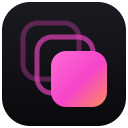
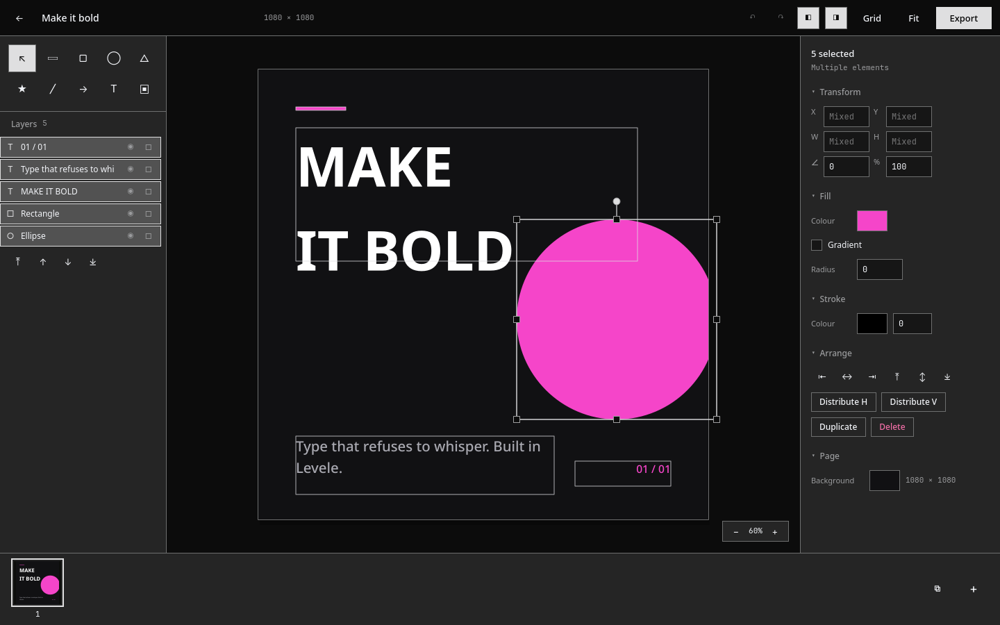
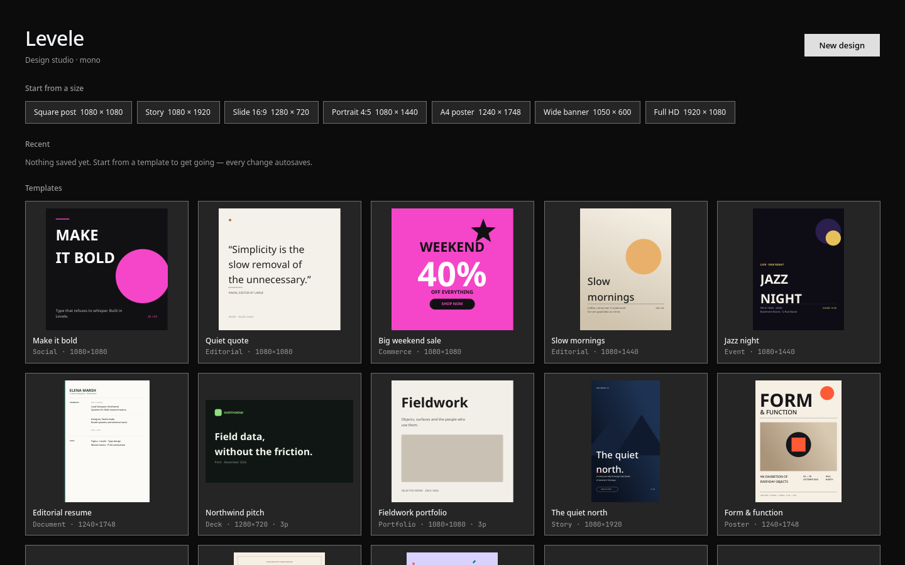

<p align="center">
  
</p>

<h1 align="center">Levele (Native)</h1>

<p align="center">
  <strong>Local-first layered design studio built with C++17 and Qt Quick 6 for Arch Linux &amp; Omarchy.</strong><br>
  Fifteen editable templates, real layers, smart snapping guides, multi-page documents, and PNG/PDF/GIF export in a single native binary.
</p>

<p align="center">
  
  
  
  
  
</p>

<p align="center">
  <a href="#features">Features</a>
  ·
  <a href="#screenshots">Screenshots</a>
  ·
  <a href="#build--install">Build &amp; Install</a>
  ·
  <a href="#testing">Testing</a>
  ·
  <a href="#project-layout">Project Layout</a>
  ·
  <a href="#documentation">Documentation</a>
</p>

---



**Levele (Native)** is the C++17 / Qt Quick 6 desktop port of Levele. Start blank, pick a preset size, or open one of fifteen built-in templates for social posts, stories, posters, pitch decks, resumes, and portfolios, then export high-DPI PNGs, multi-page PDFs, or animated GIFs — completely offline with no accounts, no telemetry, and no network calls.

A **NODAYSIDLE** open-source project. MIT licensed.

---

## Features

- **Templates & Custom Canvases:** 15 built-in multi-layer templates plus custom canvas dimensions (`16×16` to `16384×16384`).
- **Shapes, Lines, Text & Images:** Rectangles, rounded shapes, gradients, signed-vector lines and arrows (with dedicated stroke and geometry controls), inline-editable text (`Enter` or double-click), and images with bounded caching.
- **Layers & Multi-Page Workflow:** Drag-reorderable layers panel with lock/unlock, visibility toggle, inline rename, and `Alt+↑`/`Alt+↓` keyboard reordering; multi-page strip with drag-reorder, duplicate, and delete.
- **Precision Editing:** Smart snapping guides, multi-select alignment and distribution, undo/redo history, wheel/pinch zoom and pan, and 7-day trash restore.
- **Atomic Saves & Background Exports:** `QSaveFile` atomic document persistence and `QtConcurrent` background exports to high-DPI PNG, multi-page PDF, and streamed/paletted animated GIF.
- **Omarchy & Hyprland Native Integration:** Reads Omarchy theme palettes and Hyprland corner radius dynamically (live-reloading via `.socket2.sock`), renders custom-painted Basic-style controls with verified WCAG AA contrast across 83 themes, and uses `xdg-desktop-portal` over D-Bus (with Qt dialog fallback) for native file pickers.
- **Keyboard & Accessibility First:** Full Tab traversal, `theme.accent` focus rings, `Accessible.*` annotations, and `qsTr()` i18n hooks.

---

## Screenshots

| Editor | Dashboard |
| :---: | :---: |
|  |  |

---

## Build & Install

### Dependencies (Arch Linux)

```bash
sudo pacman -S qt6-base qt6-declarative qt6-svg
```

Optional for generating PNG icon sizes during install: `imagemagick` or `librsvg`.

### Build & Per-User Install

```bash
# Build release binary -> build/levele
./bin/build

# Build and install to ~/.local/bin/levele, icons, and desktop entry
./bin/install
```

`install.sh` installs strictly inside `$HOME` (`~/.local/bin/levele`, `~/.local/share/icons/hicolor/*/apps/levele.*`, and `~/.local/share/applications/com.nodaysidle.levele.desktop`).

---

## Testing

```bash
# Build + offscreen self-test (15 templates, PNG/PDF/GIF exports, geometry) + 83-theme contrast sweep
./bin/test

# Unit & integration tests (39 tests; use dbus-run-session to include portal D-Bus round-trip)
mkdir -p build-tests && (cd build-tests && qmake6 ../tests/levele_tests.pro && make -j"$(nproc)")
QT_QPA_PLATFORM=offscreen QT_QPA_PLATFORMTHEME= dbus-run-session -- ./build-tests/levele_tests

# Offscreen QML acceptance harness (18 scenarios: layout, compact 640x480, a11y, focus walk, modals)
mkdir -p build-harness && (cd build-harness && qmake6 ../tests/qml-harness/harness.pro && make -j"$(nproc)")
QT_QPA_PLATFORM=offscreen ./build-harness/harness

# Independent Python WCAG contrast check across Omarchy themes
python3 tests/contrast.py
```

---

## Project Layout

| Path | Purpose |
| :--- | :--- |
| `src/` | C++17 core: `Studio` controller, `CanvasItem` interaction/rendering, `Document` model, `Exporter` (PNG/PDF/GIF), `Theme` (Omarchy/Hyprland), `Templates`, and `PortalFileChooser` |
| `qml/` | Qt Quick 6 screens (`Dashboard`, `Editor`, `CanvasStage`, `LayersPanel`, `Inspector`, `PageStrip`, `ExportDialog`, `ShortcutsOverlay`) and custom controls in `qml/ui/` |
| `assets/` | Application SVG icon (`levele.svg`) bundled via `resources.qrc` |
| `bin/` | Shell wrappers for `build`, `install`, and `test` |
| `tests/` | Qt Test unit/integration suite (`levele_tests.cpp`), offscreen QML harness (`qml-harness/harness.cpp`), and `contrast.py` |
| `docs/` | Handoff & audit logs, archived history, and documentation screenshots |

---

## Documentation

- [docs/HANDOFF.md](docs/HANDOFF.md) — Current audit, remediation log, verification counts, and install notes
- [docs/archive/HANDOFF.2026-11-18.prev.md](docs/archive/HANDOFF.2026-11-18.prev.md) — Earlier architecture and build record

---

## License

[MIT](LICENSE) — Copyright (c) 2026 Levele contributors.
